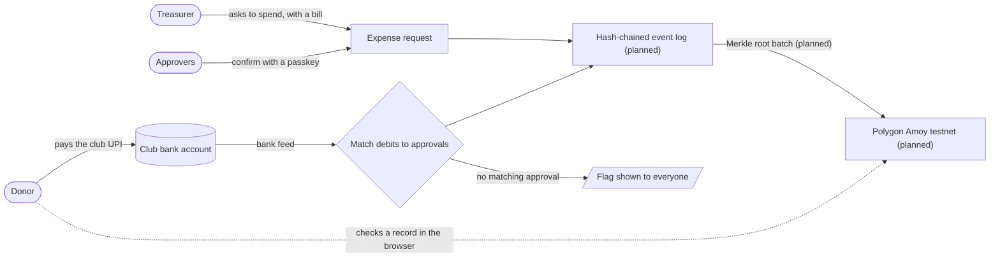

<div align="center">


# Yen

**Community money you can check.**<br>
Donors verify every rupee. Treasurers cannot quietly spend it. <!-- claim: CLAIM-01 -->

[](https://github.com/aetosdios27/Yen/actions/workflows/ci.yml)
[](https://github.com/aetosdios27/Yen/actions/workflows/codeql.yml)
[](CONTRIBUTING.md)
[](SECURITY.md)

[](tsconfig.base.json)
[](.nvmrc)
[](package.json)
[](#built-with)
[-8247E5?logo=polygon&logoColor=white)](#built-with)

[Why Yen](#why-yen) · [How it works](#how-it-works) · [Guarantees and limits](#guarantees-and-limits) · [Built with](#built-with) · [Roadmap](#roadmap) · [Getting started](#getting-started) · [Deployment](#deployment)

</div>

---

## Why Yen

Clubs, festivals, housing societies and small NGOs collect money through personal UPI accounts and spreadsheets. Donors cannot verify where the money went, while honest treasurers cannot prove their integrity. When questions arise, disputes are settled by whoever is loudest rather than checkable records.

## How it works

Yen **never holds money**. <!-- claim: CLAIM-02 --> Funds stay in the club's own bank account. This section describes the design; most of it is still being built and nothing is deployed yet. Yen watches the account, enforces configured spending approvals, and ensures any change would be detected. <!-- claim: CLAIM-03 -->



1. **Donations go directly to the club bank account.** The bank feed confirms incoming payments, so a payment is recorded only when the bank reports it. <!-- claim: CLAIM-13 -->
2. **Spending requires permission.** The treasurer submits an expense request with a bill. Configured approvers confirm with a 6-digit Yen PIN (recorded by Yen after PIN confirmation), and donors receive an objection window. <!-- claim: CLAIM-12 --> <!-- claim: CLAIM-15 --> <!-- claim: CLAIM-30 -->
3. **Debits match approved requests.** Bank debits are reconciled against approved requests. Any debit without a matching approval is flagged publicly. <!-- claim: CLAIM-14 -->
4. **Events are hash-chained in the event log (planned).** Each record includes the cryptographic hash of the prior record, ensuring any change would be detected. <!-- claim: CLAIM-03 -->
5. **Merkle roots anchor to a public chain (planned).** Periodic root hashes are published to the Polygon Amoy testnet without names or amounts. <!-- claim: CLAIM-10 --> Anyone can verify proofs locally in the browser. <!-- claim: CLAIM-09 -->

<a id="what-we-promise-and-what-we-dont"></a>
## Guarantees and limits

We only claim what a skeptic can check.

<!-- claim: CLAIM-03 -->
<!-- claim: CLAIM-12 -->
<!-- claim: CLAIM-14 -->
<!-- claim: CLAIM-11 -->

| We guarantee                                                 | We do not guarantee                                                                                                             |
| ------------------------------------------------------------ | ------------------------------------------------------------------------------------------------------------------------------- |
| Any change or deletion of a recorded event would be detected | That a bill is genuine. We verify it was not altered after upload, not that the vendor is real                                  |
| Spending needs the approvals the club configured             | That a treasurer cannot misuse money. They cannot do so undetected, but in observer mode they can still pay from their bank app |
| Bank debits are compared against approvals                   | Anything about cash. Cash is not in the bank feed                                                                               |
| Personal data stays off the chain                            | That operators cannot inspect database records. Privacy tiers limit what others see                                             |

<a id="tech"></a>
## Built with

| Component          | Technology                                                                                             |
| ------------------ | ------------------------------------------------------------------------------------------------------ |
| Languages          | TypeScript (strict), Solidity                                                                          |
| Monorepo           | pnpm workspaces, Turborepo                                                                             |
| Quality            | Biome, Vitest, Foundry, Playwright (planned)                                                           |
| Web app            | Next.js with a shared design system and EN/HI i18n; PWA planned                                        |
| API                | Hono HTTP service with health, readiness and build version endpoints                                   |
| Data & ledger      | PostgreSQL 16, [Konto](https://github.com/aetosdios27/Konto) double-entry ledger integration (planned) |
| Event log          | Hash-chained event log (planned)                                                                       |
| Proofs & anchoring | SHA-256, Merkle trees, Polygon Amoy testnet anchoring (planned for MVP)                                |
| Auth               | Phone OTP, WebAuthn passkeys for approvals (planned)                                                   |

<a id="status"></a>
## Roadmap

Delivery is structured into six focus areas:

| Stage                          | Deliverables                                                                            | Status      |
| ------------------------------ | --------------------------------------------------------------------------------------- | ----------- |
| Foundation                     | Monorepo workspace, CI pipelines, security scanning and repository rulesets             | In progress |
| Identity and ledger core       | Authentication, role permissions, double-entry ledger and hash-chained event log        | Planned     |
| Funds and spending             | Donation intake, expense requests, passkey approvals, bill uploads and donor objections | Planned     |
| Transparency layer             | Client-side Merkle proof verification, public fund view and testnet anchoring           | In progress |
| Money rails and reconciliation | Bank feed integration and unapproved debit alerts                                       | Planned     |
| Hardening and pilot            | Security review, data privacy review and initial community pilot                        | Planned     |

## Repository layout

```
apps/web/         Next.js app, design system and EN/HI i18n
apps/api/         Hono HTTP service with health, readiness and build version endpoints
packages/shared/  Integer paise, branded IDs, Merkle proofs
packages/ledger/  Placeholder for ledger integration
packages/eventlog/ Placeholder for the append-only event log
contracts/        Placeholder; RootRegistry is planned in YEN-16
.github/          CI, rulesets, templates, repo-settings script
.greptile/        AI review rules specific to this repo
```

Money is always **integer paise** with the branded `Paise` type, never floats. <!-- claim: CLAIM-16 -->

## Getting started

```sh
nvm use                # Node 24.21.0 (see .nvmrc)
pnpm install
pnpm verify            # biome ci + typecheck + test + build
```

To run the apps locally, first run `pnpm verify` above to build the API, then copy the example environment files:

```sh
cp apps/api/.env.example apps/api/.env
cp apps/web/.env.example apps/web/.env
pnpm --filter @yen/api start  # API on port 3001
```

In a second terminal, start the web app on port 3000:

```sh
pnpm --filter @yen/web dev
```

The API requires `PORT`, and the web app requires an HTTP(S) `NEXT_PUBLIC_API_URL`. The example files provide local values. `pnpm format` auto-fixes formatting and safe lint issues.

The shared design system lives in `apps/web`; open `http://localhost:3000/design-system` for its 375 px review page. See [`apps/web/README.md`](apps/web/README.md) for tokens, components, language switching and accessibility checks.

## Deployment

The web app deploys to Vercel from `apps/web`. Pull requests get a preview URL
from the Vercel bot; `main` deploys production only after an approved pull
request passes **CI Gate**. Project setup, environment scopes and the
single-gate policy are in [`docs/deployment/web.md`](docs/deployment/web.md).
If production breaks, use the
[web rollback runbook](docs/runbooks/web-rollback.md).

<a id="how-we-work"></a>
<a id="security"></a>
## Contributing and security

Direct pushes to `main` are blocked. Every change needs passing CI checks. <!-- claim: CLAIM-23 --> See [CONTRIBUTING.md](CONTRIBUTING.md) for pull request guidelines and [`.github/rulesets/`](.github/rulesets) for branch protection policies.

To report security vulnerabilities privately, follow [SECURITY.md](SECURITY.md). Any path that permits editing recorded events, bypassing configured approvals, or holding user funds is treated as critical.

## License

All rights reserved until an open-source license is selected.
