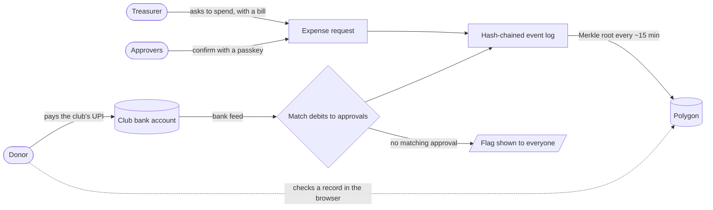

<div align="center">


# Yen

**Community money you can check.**<br>
Donors verify every rupee. Treasurers can't quietly spend it.

[](https://github.com/aetosdios27/Yen/actions/workflows/ci.yml)
[](https://github.com/aetosdios27/Yen/actions/workflows/codeql.yml)
[](CONTRIBUTING.md)
[](SECURITY.md)
[](#status)

[](tsconfig.base.json)
[](.nvmrc)
[](package.json)
[](#how-it-works)
[-8247E5?logo=polygon&logoColor=white)](#how-it-works)
[](https://github.com/aetosdios27/Yen/commits/main)

[Why](#why-yen) · [How it works](#how-it-works) · [What we promise](#what-we-promise-and-what-we-dont) · [Status](#status) · [Getting started](#getting-started) · [Contributing](CONTRIBUTING.md)

</div>

---

## Why Yen

Clubs, festivals, temples, housing societies and small NGOs run on UPI and cash collected by one person, tracked in a spreadsheet or a WhatsApp group. Donors can't check where the money went. Honest treasurers can't prove they're honest. Disputes get settled by whoever is louder.

Yen makes the record checkable instead of trusted.

## How it works

Yen **never holds your money**. It stays in the club's own bank account. Yen watches the account, enforces who must approve spending, and keeps a record nobody can quietly rewrite.



1. **Donations** go straight to the club's UPI. The bank confirms them, so a claimed payment isn't counted until the bank shows it.
2. **Spending needs permission.** The treasurer files an expense with a bill photo. A quorum of approvers confirms with a passkey, and donors get a window to object.
3. **Every bank debit is matched** to an approved request. Money that left without approval is flagged to everyone.
4. **Every event is chained.** Each record includes the hash of the one before it, so any edit or deletion breaks the chain.
5. **Fingerprints go on a public chain.** Only a Merkle root is published, never names or amounts. Anyone can recompute and check a record in their browser, without trusting us.

## What we promise, and what we don't

We only claim what a skeptic can check.

| We guarantee                                           | We do not guarantee                                                                                                            |
| ------------------------------------------------------ | ------------------------------------------------------------------------------------------------------------------------------ |
| A recorded event can't be changed or deleted unnoticed | That a bill is genuine. We prove it wasn't altered after upload, not that the vendor is real                                   |
| Spending needs the approvals the club configured       | That a treasurer can't misuse money. They can't do it _unnoticed_, but in observer mode they can still pay from their bank app |
| Bank debits are compared against approvals             | Anything about cash. It isn't in the bank feed                                                                                 |
| Personal data stays off the chain                      | That we can't see your data. Privacy tiers limit what _others_ see                                                             |

## Status

**Pre-MVP.** Foundation phase; nothing is deployed yet. The plan is tracked in Linear (team access) and summarised here.

| Milestone                 | Goal                                              | Target   |
| ------------------------- | ------------------------------------------------- | -------- |
| M0 Foundation             | Repo rules, CI, monorepo, previews, staging       | Nov 2026 |
| M1 Identity & ledger core | Auth, roles, ledger, tamper-evident log           | Dec 2026 |
| M2 Funds & spending       | Donations, requests, approvals, bills, objections | Jan 2027 |
| M3 Transparency layer     | Public fund page, Merkle proofs, chain anchoring  | Jan 2027 |
| M4 Money rails            | Bank reconciliation, unapproved-debit alerts      | Jan 2027 |
| M5 Hardening & pilot      | Security review, DPDP, one real club              | Feb 2027 |

Dates are targets, not promises.

## Tech

| Layer    | Choice                                                                           |
| -------- | -------------------------------------------------------------------------------- |
| Language | TypeScript (strict), Solidity                                                    |
| Monorepo | pnpm workspaces, Turborepo                                                       |
| Quality  | Biome, Vitest, Foundry (contracts), Playwright (e2e, planned)                    |
| Web      | Next.js PWA (planned)                                                            |
| Data     | PostgreSQL 16, [Konto](https://github.com/aetosdios27/Konto) double-entry ledger |
| Proofs   | SHA-256 hash chain, Merkle trees, Polygon (Amoy testnet in MVP)                  |
| Auth     | Phone OTP, WebAuthn passkeys for approvals (planned)                             |

## Repository layout

```
apps/        web (Next.js) and api (Hono)             - coming with YEN-11
packages/    shared: money (paise), Merkle verify     - started
             ledger, eventlog                          - planned
contracts/   Foundry RootRegistry, tests, Amoy deploy - YEN-16; see contracts/README.md
infra/       Terraform                                - planned, YEN-17
.github/     CI, rulesets, templates, repo-settings script
.greptile/   AI review rules specific to this repo
```

Money is always **integer paise** with the branded `Paise` type, never floats.

## Getting started

```sh
nvm use                # Node 24 (see .nvmrc)
pnpm install
pnpm verify            # biome ci + typecheck + test + build
```

Other commands: `pnpm format` auto-fixes formatting and safe lint issues.

## How we work

`main` is protected by rulesets with no bypass for anyone: every change is a pull request, approved by someone other than its author, with **CI Gate** green. Merges are squashed. The full flow is in [CONTRIBUTING.md](CONTRIBUTING.md), and the rules themselves live in [`.github/rulesets/`](.github/rulesets).

## Security

Please report vulnerabilities privately; see [SECURITY.md](SECURITY.md). Short version: we will never edit recorded events, bypass an approval, or hold users' funds, and any path that allows one is a high-severity report.

## License

Not yet decided; all rights reserved until we choose one.
