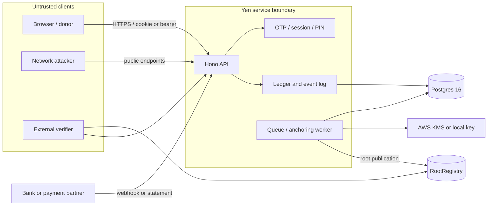

# Threat model — current implementation (YEN-47, 2026-10-29)

This replaces the early pre-implementation snapshot. It records the code and tests reviewed for YEN-47 on `origin/main` at `0182c1c6e00e65752cbe04072ac5f419b0063d4f`. Status describes the reviewed code, not an unverified deployment.

## Method and status meanings

STRIDE was applied to the browser/API, API/database, bank-feed, background-worker, and chain boundaries. Evidence pointers name source or tests opened during this review. An open status may point to the vulnerable path or state that the repository contains no implementation for the modeled capability.

- **Mitigated:** code and a relevant test demonstrate the stated control for the scoped path.
- **Partial:** a control exists, but does not cover the whole threat or has a concrete residual risk.
- **Open:** no effective control was found for the threat in the reviewed code.

`Severity` estimates impact if the threat succeeds. High findings SEC-1 and SEC-2 are tracked in [issue #102](https://github.com/aetosdios27/Yen/issues/102) and [issue #103](https://github.com/aetosdios27/Yen/issues/103); details and fixes are in [`docs/security/review-2026-10.md`](security/review-2026-10.md).

## Assets, actors, and trust boundaries

**Assets:** money balances and holds; expense requests and approvals; bank transaction assertions; OTPs, PINs, sessions and trusted devices; member roles; evidence bytes and metadata; event history and anchor keys; private identity/contact data.

**Actors:** anonymous donor; signed-in member; approver/treasurer; fund owner; payment partner; API/database operator; anchoring worker; external verifier; network attacker with or without a stolen session.

**Reachability note:** the current server bootstrap wires persistent auth, PIN, expense, pledge, and reconciliation stores but not a persistent fund store or an allowing production policy (`apps/api/src/server-bootstrap.ts:144`, `apps/api/src/dependencies.ts:252`). The default policy denies all (`apps/api/src/dependencies.ts:282`). Protected money-route findings therefore describe handler behavior under a policy that grants the relevant action; the committed bootstrap currently denies those actions. The partner webhook is outside those auth gates and is independently reachable.

## Existing threats

| ID                                                       | STRIDE | Severity | Status        | Evidence and residual risk                                                                                                                                                                                                                                                                                                                      |
| -------------------------------------------------------- | ------ | -------- | ------------- | ----------------------------------------------------------------------------------------------------------------------------------------------------------------------------------------------------------------------------------------------------------------------------------------------------------------------------------------------- |
| D1 Donation verified without a bank credit               | S, T   | High     | **Open**      | `apps/api/src/app.ts:1727` accepts partner JSON without sender authentication; `apps/api/src/reconciliation/reconciliation.test.ts:179` exercises an unsigned request. See SEC-1.                                                                                                                                                               |
| D2 Replayed pledge creates a duplicate                   | R, T   | Medium   | **Partial**   | UTR is unique across pledges (`packages/db/migrations/0011_donation_pledges.sql:15`) and HTTP retries bind to a request hash (`apps/api/src/middleware.ts:302`); webhook records are deduplicated by `(fund_id, bank_reference)` (`packages/db/migrations/0019_bank_transactions.sql:26`). Forged unique references remain possible under D1.   |
| D3 Amount or fund changes before verification            | T      | Medium   | **Partial**   | Pledge amounts require safe integer paise (`packages/ledger/src/operations.ts:347`) and exact amount/UTR matching (`apps/api/src/reconciliation/matching-engine.ts:54`), but an unauthenticated webhook can make the matching transaction assertion (`apps/api/src/app.ts:1729`).                                                               |
| D4 QR swap at collection point                           | T, S   | High     | **Open**      | No QR generation or payment destination confirmation flow was found in the API contract; donation pledge handling starts at `apps/api/src/contract.ts:1412`.                                                                                                                                                                                    |
| E1 Forged approval                                       | S      | High     | **Partial**   | Approvals require `can()` and action-bound PIN proof (`apps/api/src/app.ts:1034`, `apps/api/src/app.ts:1044`); concurrent PIN failures can defeat the lockout (`apps/api/src/pin/service.ts:243`). See SEC-2.                                                                                                                                   |
| E2 Replayed request or approval action                   | R, T   | Medium   | **Partial**   | HTTP replay protection is implemented (`apps/api/src/middleware.ts:281`) and action tokens are one-use in memory (`apps/api/src/pin/store.ts:193`); OTP and auth routes bypass HTTP idempotency and rely on database challenge consumption (`apps/api/src/auth/stores.ts:617`). Action tokens are not shared across API processes.              |
| E3 Treasurer approves own request                        | E      | High     | **Mitigated** | Route and state-machine checks reject requester self-approval (`apps/api/src/app.ts:1036`, `packages/ledger/src/expense/state-machine.ts:199`); tests cover this (`apps/api/src/expense.test.ts:270`, `packages/ledger/src/expense/state-machine.test.ts:162`).                                                                                 |
| E4 Evidence swapped after approval                       | T      | High     | **Partial**   | Upload computes a server hash (`apps/api/src/app.ts:1608`) and reads verify it (`apps/api/src/integrity-job.ts:45`), but EXIF-stripped bytes are discarded and original bytes are returned to evidence readers (`apps/api/src/app.ts:1615`, `apps/api/src/app.ts:853`).                                                                         |
| E5 Objection suppressed or resolved silently             | R, D   | Medium   | **Partial**   | The ledger state machine models objection windows and tests their transitions (`packages/ledger/src/expense/state-machine.test.ts:390`); no corresponding objection API route was found in `apps/api/src/contract.ts` or `apps/api/src/app.ts`, so end-to-end availability and authorization are not established.                               |
| P1 Payout without an approved request                    | S, E   | High     | **Mitigated** | `/pay` checks `can()` and `status === approved` before committing the hold (`apps/api/src/app.ts:1167`); Postgres locks the expense row and commits the hold transactionally (`apps/api/src/expense-store.ts:80`, `apps/api/src/expense-store.ts:115`). API lifecycle tests cover status transitions (`apps/api/src/expense.test.ts:211`).      |
| P2 Payout amount or payee differs from approval          | T      | High     | **Open**      | `/pay` trusts the supplied bank transaction ID (`apps/api/src/app.ts:1174`) and ledger settlement does not look up a bank debit (`packages/ledger/src/expense/service.ts:297`). The payee is not bound to an observed bank transaction. See SEC-3.                                                                                              |
| P3 Duplicate or hidden payout                            | R, T   | Medium   | **Partial**   | HTTP requests are idempotent (`apps/api/src/middleware.ts:281`) and hold commits happen in the DB transaction (`packages/ledger/src/expense/service.ts:297`); no external bank transfer is executed or idempotently controlled by this repository.                                                                                              |
| R1 Insider with DB write access rewrites history         | T, R   | High     | **Partial**   | Event rows are append-only for the app role, enforced by grants and triggers (`packages/db/migrations/0003_fund_events.sql:582`); tests verify UPDATE/DELETE/TRUNCATE rejection (`packages/db/src/events.test.ts:720`). A database owner can still bypass application-level controls; anchoring detects committed roots only after publication. |
| R2 Truncated log                                         | T, R   | High     | **Mitigated** | Verification accepts an authenticated expected head and detects truncation (`packages/eventlog/src/chain.ts:82`, `packages/eventlog/src/eventlog.test.ts:749`). The caller must retain or obtain a trustworthy head.                                                                                                                            |
| R3 Backdated event                                       | T, R   | Medium   | **Partial**   | Event construction rejects time moving before the prior event (`packages/eventlog/src/chain.ts:53`); it does not require event time to be close to trusted server time.                                                                                                                                                                         |
| R4 Unapproved debit matched to an approved request       | S, T   | High     | **Open**      | Expense reconciliation compares only the caller-supplied transaction ID and writes `bank.debit_seen` without checking an ingested bank row (`apps/api/src/app.ts:1213`, `packages/ledger/src/expense/service.ts:351`). See SEC-3.                                                                                                               |
| V1 Split view: different roots shown to different people | T, R   | High     | **Partial**   | The registry has one append-only sequence (`contracts/src/RootRegistry.sol:44`); worker reconciliation compares recomputed, persisted, and on-chain roots (`packages/queue/src/anchoring.ts:328`). A client consistency monitor and reorg recovery are not complete (`packages/queue/README.md:44`).                                            |
| V2 Publisher key compromise                              | S, E   | High     | **Partial**   | KMS signing is supported (`packages/queue/src/anchoring.ts:98`), but CLI falls back to a local private key whenever KMS is unset (`packages/queue/src/cli.ts:43`). The contract has one publisher with two-step transfer, not a multisig (`contracts/src/RootRegistry.sol:29`, `contracts/src/RootRegistry.sol:63`). See SEC-5.                 |
| V3 PII or sensitive linkage on chain                     | I      | High     | **Mitigated** | Event schemas are strict and use per-fund pseudonyms, with no phone, display name, contact, or user UUID fields (`packages/eventlog/src/model.ts:43`); pseudonym tests assert different IDs per fund (`packages/db/src/pseudonyms.test.ts:50`).                                                                                                 |
| V4 Verify page shows unqualified “verified”              | T      | Medium   | **Mitigated** | Public timeline items are explicitly marked `unverified` (`apps/api/src/app.ts:802`); public proof tests check that raw evidence content is withheld from public viewers (`apps/api/src/public-expense.test.ts:160`).                                                                                                                           |
| V5 Cross-fund linking through pseudonyms                 | I      | Medium   | **Mitigated** | Random pseudonyms are keyed per `(user, fund)` (`packages/db/src/pseudonyms.ts:35`); tests verify distinct pseudonyms across funds (`packages/db/src/pseudonyms.test.ts:50`).                                                                                                                                                                   |
| V6 Erasure request conflicts with statutory retention    | R, I   | Medium   | **Open**      | Identity/contact data lives in `users` (`packages/db/migrations/0001_app_tables.sql:1`); no user-erasure workflow was found in `apps/api/src/auth/stores.ts` or the API contract. Retention and erasure policy remains unimplemented in this code review.                                                                                       |
| X1 Phone or waitlist enumeration                         | I      | Medium   | **Mitigated** | Unknown phone and invalid code return the same error (`apps/api/src/auth.test.ts:455`); OTP attempts are limited across channels (`apps/api/src/auth.test.ts:415`).                                                                                                                                                                             |
| X2 Rate-limit evasion                                    | D      | Medium   | **Partial**   | Production bootstrap uses Postgres-backed rate limits (`apps/api/src/server-bootstrap.ts:114`); client IP ignores forwarded headers unless trusted hops are configured (`apps/api/src/client-ip.ts:109`). Distributed sources can still spread requests across IP buckets.                                                                      |
| X3 External attacker on the public API                   | S, E   | Medium   | **Partial**   | Fund/auth routes require a principal (`apps/api/src/app.ts:290`, `apps/api/src/app.ts:303`) and public read/donation paths are explicit (`apps/api/src/middleware.ts:19`). Partner webhook is an unauthenticated exception (`apps/api/src/app.ts:1727`).                                                                                        |
| X4 Member grants self a role                             | E      | High     | **Partial**   | Fund member routes call `authorizedFund` (`apps/api/src/auth/invite-routes.ts:37`); owner-vouched completion creates only role `member` (`apps/api/src/auth/stores.ts:715`). The production bootstrap currently has no persistent fund policy adapter, so full deployed membership authorization was not established.                           |
| X5 Compromised platform operator                         | T, R   | High     | **Partial**   | Hash chaining and append-only triggers help detect retrospective edits (`packages/db/src/events.ts:295`, `packages/db/migrations/0003_fund_events.sql:582`); an operator can still append false data before it is anchored, and D1 is an unauthenticated false-data path.                                                                       |
| X6 Dev principal reaches production                      | E      | Low      | **Mitigated** | Default principal is null and default policy is deny-all (`apps/api/src/dependencies.ts:282`); production server startup requires a Postgres expense store and does not accept a principal override (`apps/api/src/dependencies.ts:233`, `apps/api/src/server-bootstrap.ts:144`).                                                               |
| X7 Approver credential or PIN compromise                 | S      | High     | **Partial**   | PINs use a keyed HMAC (`apps/api/src/pin/crypto.ts:20`), protected routes require PIN or bound one-use token (`apps/api/src/pin/service.ts:468`), but lockout counters race under concurrency (SEC-2).                                                                                                                                          |
| X8 SIM swap or recycled number inherits roles            | S, E   | High     | **Partial**   | OTP authenticates phone possession, but an untrusted device does not get a principal until device trust requirements pass (`apps/api/src/middleware.ts:105`); reset enters a cooling-off period and notifies members (`apps/api/src/pin/service.ts:423`). Phone recycling and recovery policy still depend on operational response.             |
| X9 PIN online brute force                                | S      | High     | **Partial**   | Sequential failures trigger five-attempt/30-minute and ten-attempt/24-hour lockouts (`apps/api/src/pin/service.ts:251`, `apps/api/src/pin/service.ts:274`), but lost updates allow concurrent attempts to bypass those counters (SEC-2).                                                                                                        |
| X10 PIN offline cracking after database leak             | I, S   | High     | **Partial**   | PIN hash is keyed with `PIN_HMAC_SECRET` (`apps/api/src/pin/crypto.ts:20`) and invalid short keys are rejected (`apps/api/src/dependencies.ts:130`); production env parsing does not require this key, though missing key makes PIN actions fail closed (`apps/api/src/pin/service.ts:60`).                                                     |
| X11 PIN phishing on lookalike site                       | S      | High     | **Open**      | Approval proof binds to action details and expires (`apps/api/src/pin/service.ts:468`), but the PIN itself is reusable and no hardware-backed approval is used by this route.                                                                                                                                                                   |
| X12 Owner-vouched invite interception                    | S, E   | Medium   | **Partial**   | Invite code is random, stored hashed, time-limited, phone-bound, and owner-confirmed (`apps/api/src/auth/invite-routes.ts:42`, `apps/api/src/auth/stores.ts:664`, `apps/api/src/auth/stores.ts:679`). It remains a bearer secret delivered by an out-of-band channel.                                                                           |

## Additional findings from this review

| Finding                                              | STRIDE | Severity | Status   | Evidence                                                                                                                              |
| ---------------------------------------------------- | ------ | -------- | -------- | ------------------------------------------------------------------------------------------------------------------------------------- |
| SEC-1 Unauthenticated partner webhook                | S, T   | High     | **Open** | `apps/api/src/app.ts:1727`; [issue #102](https://github.com/aetosdios27/Yen/issues/102).                                              |
| SEC-2 PIN lockout lost-update race                   | S, T   | High     | **Open** | `apps/api/src/pin/service.ts:243`, `packages/db/src/approval-pin.ts:63`; [issue #103](https://github.com/aetosdios27/Yen/issues/103). |
| SEC-3 Caller-chosen expense bank transaction ID      | T, R   | Medium   | **Open** | `apps/api/src/app.ts:1174`, `apps/api/src/app.ts:1213`, `packages/ledger/src/expense/service.ts:351`.                                 |
| SEC-4 Raw evidence retains EXIF                      | I      | Medium   | **Open** | `apps/api/src/app.ts:1615`, `apps/api/src/app.ts:853`.                                                                                |
| SEC-5 Local signer fallback is not environment-gated | E      | Medium   | **Open** | `packages/queue/src/cli.ts:43`.                                                                                                       |
| SEC-6 No repository-defined browser security headers | E, I   | Low      | **Open** | `apps/web/next.config.ts:11`, `apps/web/vercel.json:1`.                                                                               |

## Operational and deployment limits

- The RootRegistry contract contains only roots and publication sequence; it cannot prove event completeness, off-chain availability, or finality (`contracts/src/RootRegistry.sol:5`, `contracts/src/RootRegistry.sol:10`).
- Queue anchoring has KMS support and root comparison, but production key selection must be fixed before claims about KMS-only custody are made (`packages/queue/src/cli.ts:43`).
- The code review did not verify a live bank partner, a production policy/fund-store adapter, production proxy/CORS/header settings, deployed contracts, AWS KMS IAM policy, or a production evidence-storage bucket. Those deployment controls remain outside the evidence in this repository.
