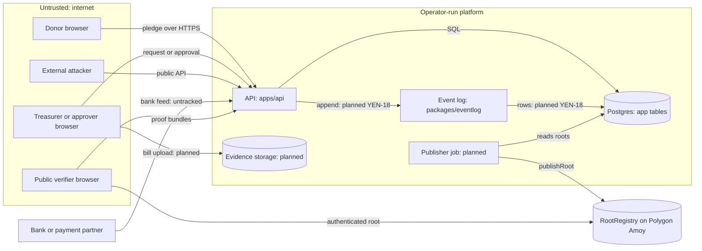

# Early threat model

This model is written before event persistence, roles, approvals, and passkeys exist. It describes the code at `b63082c`, the base of `aetosdios27/yen-66-early-threat-model`, and the planned work that the repo names. Its purpose is to shape the design now, while the v1 event payloads are still provisional.

No threat in this model is fully mitigated today. Most money paths have no code. The controls that do exist are the event hash chain, the RootRegistry contract (not yet deployed), the API's default-deny policy, and the HTTP idempotency and rate-limit middleware.

## How to read this

- **Severity** rates the threat for the design as scoped. Most money paths have no code yet, so the likelihood today is lower than the severity.
- **Status** means:
  - `exists`: a control in this repo covers the threat as scoped.
  - `partial`: a control covers part of the threat, or covers it only once planned code lands.
  - `planned`: a doc names the control, but no code exists.
  - `none`: no control exists, and no doc names one.
- **Exists today** names a real file, function, and test. Where a test does not cover a claim, the text says so.
- **Planned** gives the Linear id from a README or doc. `untracked` means no README or doc names an id.
- **Method.** Threats come from STRIDE over a data-flow diagram ([STRIDE](REFERENCES.md#stride-approach)). Responses use the mitigate, eliminate, transfer, and accept options from the [OWASP Threat Modeling Cheat Sheet](REFERENCES.md#owasp-threat-modeling).

## Summary

| ID  | Threat                                                | STRIDE | Severity | Why                                                                                                  | Status  |
| --- | ----------------------------------------------------- | ------ | -------- | ---------------------------------------------------------------------------------------------------- | ------- |
| D1  | Donation marked verified without a bank credit        | S, T   | high     | Verified donations drive public totals, and no bank check exists                                     | none    |
| D2  | Replayed pledge creates a duplicate                   | R, T   | medium   | HTTP idempotency exists but is in memory, and no donation route exists                               | partial |
| D3  | Amount or fund changed before verification            | T      | medium   | Money wire rules exist, but no append path binds the amount yet                                      | partial |
| E1  | Forged approval                                       | S      | high     | Approval releases money, and passkeys are not built                                                  | none    |
| E2  | Replayed request or approval action                   | R, T   | medium   | Only HTTP-level idempotency exists, not domain-level                                                 | partial |
| E3  | Treasurer approves own request                        | E      | high     | Memberships allow several roles, and no rule separates them                                          | none    |
| E4  | Evidence swapped after approval                       | T      | high     | The event carries a hash field, but nothing stores or checks the bytes                               | none    |
| E5  | Objection suppressed or resolved silently             | R, D   | medium   | The envelope actor names who resolves, but nothing checks who may, and no window is built            | none    |
| P1  | Payout without an approved request                    | S, E   | high     | `expense.paid` links to no approval, and no payout code exists                                       | none    |
| P2  | Payout amount or payee differs from approval          | T      | high     | `expense.paid` carries neither amount nor payee                                                      | none    |
| P3  | Duplicate or hidden payout                            | R, T   | medium   | No idempotency covers bank calls, and reversal is only a planned event                               | none    |
| R1  | Insider with DB write access rewrites history         | T, R   | high     | The chain detects tampering only after the fact, and triggers are not built                          | partial |
| R2  | Truncated log                                         | T, R   | high     | `verifyChain` needs an authenticated head, but structure checks miss truncation                      | partial |
| R3  | Backdated event                                       | T, R   | medium   | Monotonic time is checked, and any monotonic time passes                                             | partial |
| R4  | Unapproved debit matched to an approved request       | S, T   | high     | No reconciliation exists, and `packages/ledger` is empty                                             | none    |
| V1  | Split view: different roots shown to different people | T, R   | high     | The registry rejects overwrites, but no monitor or consistency proof exists                          | partial |
| V2  | Publisher key compromise                              | S, E   | high     | One key with a two-step transfer, but no timelock, multisig, or key policy                           | partial |
| V3  | PII or sensitive linkage on chain                     | I      | high     | Payloads are strict, and leaves are salted, but disclosed proofs and public roots still leak linkage | partial |
| V4  | Verify page shows an unqualified "verified" badge     | T      | medium   | The rule is written, but no verify page exists                                                       | planned |
| X1  | Phone or waitlist enumeration                         | I      | medium   | A uniqueness constraint exists, but no lookup endpoint exists yet                                    | none    |
| X2  | Rate-limit evasion                                    | D      | medium   | Per-IP and per-principal buckets exist, but they are per process and evictable                       | partial |
| X3  | External attacker on the public API                   | S, E   | medium   | Default deny and `requireAuth` apply, but the bearer token is not validated                          | partial |
| X4  | Member grants self a role                             | E      | high     | Membership inserts have no authorization rule                                                        | none    |
| X5  | Compromised platform operator                         | T, R   | high     | Published roots resist rewrites, but the operator can withhold publication                           | partial |
| X6  | Dev principal reaches production                      | E      | low      | The mock server refuses production, but `createApp` deps accept any principal                        | partial |
| X7  | Approver credential or passkey compromise             | S      | high     | Passkeys are planned, and no authentication code exists                                              | none    |

Counts. High: 15 (D1, E1, E3, E4, P1, P2, R1, R2, R4, V1, V2, V3, X4, X5, X7). Medium: 10 (D2, D3, E2, E5, P3, R3, V4, X1, X2, X3). Low: 1 (X6).

Status: `exists` 0, `partial` 13, `planned` 1, `none` 12.

## Assets

- **Ledger.** The planned money record. `packages/ledger/src/index.ts` exports nothing. The Konto ledger is tracked as YEN-18.
- **Event log.** The v1 wire format and hashing are in `packages/eventlog`. No persistence exists. The event table and append path are planned under YEN-18.
- **Published roots.** `contracts/src/RootRegistry.sol` stores one `bytes32` per publication. No deployment exists. `contracts/deployments/amoy.json` is a template with null fields.
- **Evidence files.** Bills and receipts. No storage, upload, or table exists. The `evidence_id` and `content_sha256` fields in `expense.evidence_added` are the only planned link.
- **PII.** `users.phone` and `users.display_name` in `packages/db/migrations/0001_app_tables.sql`. The `pseudonyms` table maps a public UUID to a user, so it can be erased.
- **Signing and anchoring keys.** The publisher address comes from `ROOT_REGISTRY_PUBLISHER`, and a deployer keystore signs deployments. The repo has no key management. Event hashes are unsigned, so no event signing key exists.
- **Approver credentials and passkeys.** Planned under YEN-22. The bearer scheme is a placeholder that validates nothing.
- **Operational state.** Idempotency responses and rate-limit buckets live in memory, per process.

## Actors

- **Treasurer.** Records donations and submits expense requests. Trusted for intent. Not trusted to approve own requests.
- **Approver.** Confirms requests with a passkey. Trusted to approve honestly within the quorum.
- **Donor.** Pledges and objects. Sees only what the visibility tier allows.
- **Platform operator.** Runs the API, the database, and the publisher. Trusted with availability. Not trusted with history after publication is the design goal.
- **Compromised operator.** An attacker with operator-level access. Covered by X5.
- **Attacker with database access.** Holds SQL credentials, through a leak, a backup, or an insider. Covered by R1.
- **External attacker on the public API.** Anonymous network client. Covered by X1, X2, and X3.
- **Malicious club member.** Holds a fund membership and tries to act above its role. Covered by X4.
- **Payment partner.** The source of bank credits and debits. Treated as a trusted data source that may be wrong or forged.

## Trust boundaries and data flow

Each subgraph in the diagram is a trust boundary. A trust boundary is the border between trusted and untrusted elements ([STRIDE](REFERENCES.md#stride-approach)).

1. **Browser to API.** Every request is untrusted until `requireAuth` and the policy check pass.
2. **API to database.** The API is the only writer in the design. Triggers and revoked privileges, planned under YEN-18, are meant to enforce this for the database too.
3. **Operator to publication.** The publisher key signs root publications. Once a root is on chain, the operator cannot change it.
4. **Chain to verifier.** The verifier must authenticate a checkpoint from outside the API.
5. **Bank feed to API.** Bank data is an input that the system cannot authenticate today.

## Abuse cases by money path

Each path lists its abuse cases. Each entry gives the STRIDE category, what exists, what is planned, and the residual risk.

### Donation path

Stages: pledge, bank verification, and the verified total.

#### D1. Donation marked verified without a bank credit

- **STRIDE.** Spoofing, tampering.
- **Abuse case.** A treasurer, the operator, or an attacker records `donation.verified` with a `bank_transaction_id` that has no matching bank credit. A pledge that was never paid is verified.
- **Exists today.** None. `donation.verified` is a provisional payload in `payloadSchemas` in `packages/eventlog/src/model.ts`. `parseEvent` checks format only. No code writes or matches bank transactions.
- **Planned.** The event append path is YEN-18. Role checks are YEN-26. The bank feed integration is untracked.
- **Residual risk.** Yen cannot prove a bank transfer happened. A matching credit is a claim from the bank feed, which is a trust input. Once a false verification is hashed and published, it is hard to remove.

#### D2. Replayed pledge creates a duplicate

- **STRIDE.** Repudiation, tampering.
- **Abuse case.** A client resends the same pledge request. The result is two pledges, or two verifications of one transfer.
- **Exists today.** Partial. `idempotency` in `apps/api/src/middleware.ts` reserves a key, and `MemoryIdempotencyStore.begin` in `apps/api/src/stores.ts` returns `new`, `in_progress`, or `complete`. The test "replays the full response without executing the handler twice" in `apps/api/src/app.test.ts` covers this. Keys are scoped to the principal, and the request hash covers exact body bytes. The store is in memory, so a restart loses it. No donation route exists.
- **Planned.** The Postgres idempotency adapter is YEN-24. A domain-level uniqueness rule for a transfer is untracked.
- **Residual risk.** Idempotency guards HTTP retries only. Two requests with different keys still create two records. A released or expired key runs again, so side effects need transactional coordination.
- **Sources.** [Stripe idempotency](REFERENCES.md#stripe-idempotency), [AWS idempotent APIs](REFERENCES.md#aws-idempotency).

#### D3. Amount or fund changed before verification

- **STRIDE.** Tampering.
- **Abuse case.** A pledge is written with one amount and later shown or verified with another. Or it is moved to a different fund.
- **Exists today.** Partial. `paiseWire` in `packages/shared/src/paise-wire.ts` accepts canonical nonnegative decimal strings only. The money contract tests in `packages/eventlog/src/eventlog.test.ts` reject fractional, unsafe, and nonnumeric balances. Event hashes bind the amount, but nothing appends events yet. The fund ID is part of the event envelope. Nothing enforces that a pledge stays in one fund.
- **Planned.** YEN-18 for the append path.
- **Residual risk.** A changed amount is detected only after the event is appended and anchored. Before that, the record is editable.
- **Sources.** [Square Money](REFERENCES.md#square-money), [Fowler Money](REFERENCES.md#fowler-money).

### Expense request and approval path

Stages: submit with evidence, approve by quorum, objection window, and final status.

#### E1. Forged approval

- **STRIDE.** Spoofing.
- **Abuse case.** An approval is recorded without the approver's own consent. The forger uses a stolen session, a shared device, or a write to the event table.
- **Exists today.** None. `expense.approved` has a payload of `expense_id` only (`packages/eventlog/README.md`). Every event envelope carries an `actor` pseudonym (`packages/eventlog/src/model.ts`), so the approver is whoever appended the event. Nothing checks that the actor holds the approver role, that the approval is signed by a passkey, or that approvals are distinct. `parseEvent` checks format, not authority. The bearer security scheme in `apps/api/src/app.ts` reserves a contract and validates nothing.
- **Planned.** Passkeys are YEN-22. Roles and approvals are YEN-26.
- **Residual risk.** Passkeys bind an approval to a device and a challenge. They do not prove the approver read the request. A tricked approver can approve the wrong request. A compromised device can approve if the user confirms it.
- **Sources.** [WebAuthn Level 3](REFERENCES.md#webauthn-3) requires relying parties to use random challenges and verify returned values. [OWASP Transaction Authorization](REFERENCES.md#owasp-transaction) says users should see significant transaction data before they authorize.

#### E2. Replayed request or approval action

- **STRIDE.** Repudiation, tampering.
- **Abuse case.** A captured approval, or a repeated submit, is replayed. It counts twice toward quorum, or it creates a second expense.
- **Exists today.** Partial. The same HTTP idempotency as D2 applies to every unsafe `/v1` request, through `apps/api/src/middleware.ts`. The `(principal, key)` tuple prevents cross-user replay. Domain-level replay is not covered. No approval route exists.
- **Planned.** YEN-24 for the durable store. YEN-26 for approval rules, which would need a per-approver, per-request uniqueness rule.
- **Residual risk.** A replay with a fresh key and a valid passkey assertion is not blocked by HTTP idempotency. The approval rule must enforce one approval per approver per request.
- **Sources.** [Stripe idempotency](REFERENCES.md#stripe-idempotency), [WebAuthn Level 3](REFERENCES.md#webauthn-3).

#### E3. Treasurer approves own request (self-approval)

- **STRIDE.** Elevation of privilege.
- **Abuse case.** A treasurer submits an expense and then approves it. Or one person holds both the treasurer and approver roles in the same fund.
- **Exists today.** None. The `memberships` table in `packages/db/migrations/0001_app_tables.sql` lets one user hold several roles in a fund. `packages/db/README.md` states, "Multiple roles per user and fund are valid." No rule separates submitter and approver.
- **Planned.** Role checks are YEN-26.
- **Residual risk.** Separation of duties is a design choice. This model cites no source for it. Even with separation, approvers can collude, and the chain cannot detect collusion.

#### E4. Evidence swapped after approval

- **STRIDE.** Tampering.
- **Abuse case.** The bill is replaced after approval, so donors and approvers see a different document than the one approved.
- **Exists today.** None. `expense.evidence_added` carries `evidence_id` and `content_sha256` (`packages/eventlog/src/model.ts`). The hash field can bind bytes, but nothing computes it, stores bytes, or checks that the stored bytes match. No rule requires evidence to precede approval.
- **Planned.** Bill uploads are in the root README's "Funds and spending" row as planned work. No Linear id is named, so the work is untracked.
- **Residual risk.** A content hash binds a file only if the hash is recorded before approval and checked on every read. The hash itself is SHA-256 ([RFC 6234](REFERENCES.md#rfc-6234)), which this model assumes is collision resistant.

#### E5. Objection suppressed or resolved silently

- **STRIDE.** Repudiation, denial of service.
- **Abuse case.** A donor objects, and the objection is never recorded, or it is resolved without a visible resolver.
- **Exists today.** None. `expense.objection_raised` and `expense.objection_resolved` are provisional payloads (`packages/eventlog/README.md`). The envelope `actor` records who resolved an objection, but nothing checks that the actor may resolve it or ties the resolution to a credential. No objection window exists in code.
- **Planned.** The objection window is named in the root README as part of the product flow. No Linear id is named, so it is untracked.
- **Residual risk.** Once events are appended, a resolution is visible in the chain. Until then, nothing records who resolved it.

### Payout path

Stages: bank instruction, bank confirmation, and reversal.

#### P1. Payout without an approved request

- **STRIDE.** Spoofing, elevation of privilege.
- **Abuse case.** A payout is recorded or sent with no approved expense behind it.
- **Exists today.** None. `expense.paid` carries `expense_id` and `bank_transaction_id` only. No payout code exists. No code links a payment to an approval.
- **Planned.** The root README lists bank feed integration as planned, but it names no payout flow and no Linear id, so payouts are untracked. Role checks are YEN-26.
- **Residual risk.** Yen can record a payout that the bank made. It cannot stop a payout made outside Yen.

#### P2. Payout amount or payee differs from the approval

- **STRIDE.** Tampering.
- **Abuse case.** An approval covers one amount and one payee. The payout sends another amount to another payee.
- **Exists today.** None. `expense.paid` has no amount and no payee field (`packages/eventlog/README.md`). A reviewer comparing events cannot see a mismatch in the chain, because the chain does not record one.
- **Planned.** None names a fix. This is a design gap to close before v1 is persisted (see Decisions).
- **Residual risk.** The gap stays until the payload changes. Under the README's v1 rule, changing this after persistence needs a v2 event.

#### P3. Duplicate or hidden payout

- **STRIDE.** Repudiation, tampering.
- **Abuse case.** A payout instruction is retried, so it sends twice. Or a payout is reversed, and the reversal is not shown.
- **Exists today.** None. `expense.reversed` is a provisional event type, and no code emits it. No idempotency covers bank calls. The HTTP idempotency store in `apps/api` does not reach the bank.
- **Planned.** Bank integration is untracked. Durable idempotency is YEN-24.
- **Residual risk.** Idempotency needs the bank's own idempotency or a reconciliation step. Yen cannot assume either.
- **Sources.** [Stripe idempotency](REFERENCES.md#stripe-idempotency), [AWS idempotent APIs](REFERENCES.md#aws-idempotency).

### Reconciliation path

Stages: bank feed ingest, match, debit review, and discrepancy.

#### R1. Insider with database write access rewrites history

- **STRIDE.** Tampering, repudiation.
- **Abuse case.** A person with SQL write access edits or deletes events, then recomputes hashes for every later event so the chain still verifies.
- **Exists today.** Partial. Detection exists. `verifyChain` in `packages/eventlog/src/chain.ts` recomputes each hash and checks the links. The test "detects a changed field at that event or its successor" and "detects removal, reordering, duplication, and insertion" in `packages/eventlog/src/eventlog.test.ts` cover this. Prevention does not exist. No event table exists, and the triggers and revoked privileges that would block writes are not built.
- **Planned.** The insert trigger, update, delete, and truncate rejection, and revoked direct insert are YEN-18, as described in `packages/eventlog/README.md`.
- **Residual risk.** Table owners and superusers bypass privileges that others cannot ([PostgreSQL privileges](REFERENCES.md#pg-privileges)). Row security also does not stop owners ([PostgreSQL row security](REFERENCES.md#pg-row-security)). A rewrite that recomputes hashes is detected only against a previously authenticated head or root. An unanchored suffix can be rewritten without detection. Compromised logging machines are the class [Schneier and Kelsey](REFERENCES.md#schneier-kelsey) address.

#### R2. Truncated log

- **STRIDE.** Tampering, repudiation.
- **Abuse case.** The newest events are removed, and a verifier that trusts the shorter chain reports it as complete.
- **Exists today.** Partial. `verifyChain` needs a fund-bound `ChainHead` with a count and latest hash, so a shorter chain fails against the expected count. The test "requires an authenticated head for complete array and stream verification" in `packages/eventlog/src/eventlog.test.ts` covers this. `checkChainStructure` returns no `ok: true`, and it does not exclude truncation (`packages/eventlog/README.md`).
- **Planned.** The authenticated head comes from an anchored root, which is planned. Consistency proofs are not implemented, and the repo does not plan them under a Linear id.
- **Residual risk.** A truncation is detected only against a head that was authenticated after the removed events. Events that were never published can disappear without a trace. Consistency proofs, which [RFC 9162](REFERENCES.md#rfc-9162) and [Cox](REFERENCES.md#cox-tlog) describe, would let an auditor check that a newer log extends an older one. Yen does not implement them.

#### R3. Backdated event

- **STRIDE.** Tampering, repudiation.
- **Abuse case.** An event is written with an `occurred_at` earlier than its real time, or earlier than a payment it refers to.
- **Exists today.** Partial. `makeNextEvent` in `packages/eventlog/src/chain.ts` throws on backward time. `verifyChain` reports `non-monotonic time` at `chain.ts:204`. The test "reports first-break reasons and verifies async streams" covers this. Time is an injected input. No check compares `occurred_at` with receipt time, and a monotonic backdate passes.
- **Planned.** The database trigger for canonical UTC time order is YEN-18.
- **Residual risk.** Order is checked. Truth is not. A recorded time is an assertion by the writer, and the chain only proves it was not changed after.

#### R4. Unapproved debit matched to an approved request

- **STRIDE.** Spoofing, tampering.
- **Abuse case.** A bank debit with no approval is matched to an approved expense, so the public view shows it as approved.
- **Exists today.** None. `packages/ledger/src/index.ts` exports nothing. No matching or discrepancy code exists. `discrepancy.raised` and `discrepancy.resolved` are provisional payloads.
- **Planned.** The root README lists "unapproved debit alerts" as planned work. The ledger is tracked as YEN-18. The reconciliation work is untracked.
- **Residual risk.** A match is a claim by the matcher. A wrong or malicious match is recorded as a fact once it is appended. Yen cannot prove a bank transfer happened.
- **Sources.** [Stripe Ledger](REFERENCES.md#stripe-ledger), which describes reconciliation metrics for money movement.

### Publication and verification path

Stages: root computation, publication to the registry, publisher transfer, and client verification.

#### V1. Split view: different roots shown to different people

- **STRIDE.** Tampering, repudiation.
- **Abuse case.** The operator shows donor A one root and donor B another. Each root is internally valid, so each client's proof checks out.
- **Exists today.** Partial. `RootRegistry` rejects overwrites and replays and keeps a gapless sequence (`contracts/src/RootRegistry.sol`). Tests include `testReplayAndOverwriteAreRejected` and `testSequenceCannotWrap` in `contracts/test/RootRegistry.t.sol`. The invariants `invariantSequenceIsGaplessAndStrictlyIncreasing` and `invariantEveryPastRootIsImmutable` check the same. The verify page rule in `packages/eventlog/README.md` requires an authenticated checkpoint. Nothing monitors or compares roots across clients. The registry is not deployed, and `contracts/deployments/amoy.json` is a template.
- **Planned.** Registry deployment is YEN-16. Monitoring is untracked.
- **Residual risk.** A registry shows a sequence of roots. It cannot show that every client saw the same sequence. Clients must compare what they saw. [RFC 9162](REFERENCES.md#rfc-9162) describes monitoring and comparing tree heads for this. [CONIKS](REFERENCES.md#coniks) describes auditing equivocation while protecting privacy. Yen does neither. Withheld publication is not detected at all.

#### V2. Publisher key compromise

- **STRIDE.** Spoofing, elevation of privilege.
- **Abuse case.** An attacker with the publisher key publishes a root for a fabricated history, or proposes a new publisher the attacker controls.
- **Exists today.** Partial. Published roots cannot be overwritten, so a compromise cannot rewrite history already on chain. `publishRoot` needs the current publisher. `proposePublisher` and `acceptPublisher` need an accept step, which the current publisher cannot skip. `testFuzzUnauthorizedPublisher` and `testAcceptEmitsClearsProposalAndTransfersAllAuthority` cover those rules. The registry has one publisher, with no owner, timelock, multisig, or recovery role (`contracts/README.md`). An attacker can publish new roots at the next sequence.
- **Planned.** Key policy is untracked. The deployment check uses a throwaway key in `contracts/script/test-deploy.sh`, which is not a production policy.
- **Residual risk.** Compromise lets an attacker add false but immutable roots, and each one is then authentic. The registry cannot tell a false root from a true one. A timelock would give the community time to react, and the design does not have one.

#### V3. PII or sensitive linkage on chain

- **STRIDE.** Information disclosure.
- **Abuse case.** A name, phone number, or an identifier that links to one is written into an event or a published root.
- **Exists today.** Partial. Payloads are strict, so unknown fields are rejected. The test "rejects a raw user UUID as actor and unversioned payload additions" in `packages/eventlog/src/eventlog.test.ts` covers this. Person references are pseudonyms, and `packages/eventlog/README.md` states that names, phone numbers, VPAs, free-form notes, and raw evidence are not accepted. Only the 32-byte global root is public. Event leaves are salted with `leafHash(salt, eventHash)`, and the test "swapping salts or event hashes between distinct events fails" in `packages/shared/src/merkle/properties.test.ts` covers that. The `pseudonyms` table can be erased without cascading to history (`packages/db/README.md`). API logs omit principals, phones, and bodies (`apps/api/src/logging.ts`).
- **Planned.** The database must enforce the same payload rules under YEN-18.
- **Residual risk.** Amounts, `bank_transaction_id`, and `fund_id` stay in the disclosed proof bundles. Proof bundles go to authorized recipients. A `bank_transaction_id` may link to a bank statement and so identify a donor. Published hashes cannot be erased, which matters under the [DPDP Act](REFERENCES.md#dpdp-act). A pseudonym is not anonymous ([ICO pseudonymisation](REFERENCES.md#ico-pseudonymisation)). Whether `bank_transaction_id` is personal data is an open decision.

#### V4. Verify page shows an unqualified "verified" badge

- **STRIDE.** Tampering, in the sense that the displayed claim is altered.
- **Abuse case.** The verifier shows "verified" with no date, so a stale or obsolete checkpoint looks current.
- **Exists today.** None in code. There is no verify page. `apps/web/src/app/page.tsx` is a placeholder. `packages/eventlog/README.md` requires the UI to show "verified up to event N as of <checkpoint time>". A successful integrity result carries `verifiedAgainst`, which the UI must show.
- **Planned.** The root README lists client-side verification as in progress. No Linear id is named, so the page is untracked.
- **Residual risk.** An authentic checkpoint can still be stale. Clients must read the checkpoint time, and the design only works if the UI shows it.

### Cross-cutting threats

#### X1. Phone or waitlist enumeration

- **STRIDE.** Information disclosure.
- **Abuse case.** An attacker learns which phone numbers have accounts or waitlist entries, through login, OTP, or waitlist responses that differ.
- **Exists today.** None. `users.phone` is `UNIQUE` with an E.164 check in `packages/db/migrations/0001_app_tables.sql`. The uniqueness constraint creates the collision that an enumeration oracle would need. No login, OTP, or waitlist route exists. `apps/api/README.md` lists the six routes, and none serves these flows.
- **Planned.** Phone OTP is YEN-22. The waitlist is not named in any doc, so it is untracked.
- **Residual risk.** The unique constraint stays, so the response shape and timing decide whether enumeration works. No design yet makes responses uniform.

#### X2. Rate-limit evasion

- **STRIDE.** Denial of service.
- **Abuse case.** An attacker rotates IP addresses, or passes forwarded headers, to exceed the limit. Or the attacker fills the bucket table to evict its own exhausted bucket.
- **Exists today.** Partial. `rateLimit` in `apps/api/src/middleware.ts` applies a per-IP bucket to every `/v1` request. It also applies a per-principal bucket when a principal exists. `MemoryRateLimitStore` in `apps/api/src/stores.ts` holds 10,000 entries and evicts the oldest when full. The test "does not trust forwarded IP headers" in `apps/api/src/app.test.ts` covers forwarded headers. The test "refills token buckets by elapsed time and isolates keys" in `apps/api/src/stores.test.ts` covers refill. The server takes the socket peer address (`apps/api/src/server.ts`).
- **Planned.** A shared store is needed for more than one process. Its Linear id is untracked, although `apps/api/README.md` says it is required.
- **Residual risk.** Each process has its own buckets. More processes mean more total allowance. An attacker with enough distinct addresses is not limited by the per-IP bucket. Eviction resets an old bucket to full, so an attacker who creates more than 10,000 keys can reset its own bucket. [Stripe rate limiters](REFERENCES.md#stripe-rate-limiters) and [RFC 6585](REFERENCES.md#rfc-6585) describe the mechanism. [AWS load shedding](REFERENCES.md#aws-load-shedding) and [SRE overload](REFERENCES.md#sre-overload) describe the limit of rate limiting alone.

#### X3. External attacker on the public API

- **STRIDE.** Spoofing, elevation of privilege.
- **Abuse case.** An anonymous client calls a fund route, or sends a forged bearer token, and reads or changes data.
- **Exists today.** Partial. `requireAuth` guards `/v1/me` and `/v1/funds/*` in `apps/api/src/app.ts`. `createApp` defaults to `denyAllPolicy` (`apps/api/src/dependencies.ts`). `apps/api/src/server.ts` injects no principal, so the production entrypoint returns `unauthenticated` for these routes. The test "denies every documented funds route with the default policy" in `apps/api/src/app.test.ts` covers the policy. The bearer scheme is a placeholder, and no token is validated (`apps/api/README.md`).
- **Planned.** Token validation is YEN-22. Object-level authorization is YEN-26 and YEN-31.
- **Residual risk.** Default deny protects the current stub routes. It does not protect a future route that forgets `requireAuth`. Object-level authorization is the class [OWASP API Security](REFERENCES.md#owasp-api) names.

#### X4. Member grants self a role

- **STRIDE.** Elevation of privilege.
- **Abuse case.** A member inserts a `memberships` row for themselves with the `approver` or `treasurer` role.
- **Exists today.** None. The `memberships` table constrains the role to five values, but nothing constrains who may insert a row (`packages/db/migrations/0001_app_tables.sql`). `member.added` is a provisional event (`packages/eventlog/README.md`), and no code checks who adds a member.
- **Planned.** Role checks are YEN-26.
- **Residual risk.** Once a membership is inserted, the role takes effect unless policy checks it. A later event would record the change, but nothing prevents the change.

#### X5. Compromised platform operator

- **STRIDE.** Tampering, repudiation.
- **Abuse case.** The operator rewrites events before publication, withholds publication, or shows clients a different history.
- **Exists today.** Partial. Published roots resist rewrite (V1, V2). The verify rule requires a head from outside the API (`packages/eventlog/README.md`). `packages/shared/src/merkle/README.md` states that a root alone does not guarantee data availability. Nothing detects withheld publication.
- **Planned.** Publication is YEN-16, and its job is untracked.
- **Residual risk.** A compromised operator can rewrite anything it has not yet published. It can also refuse to publish. Yen's design relies on clients or monitors noticing a gap in the sequence, and nothing in the repo does that. [RFC 9162](REFERENCES.md#rfc-9162) and [Crosby and Wallach](REFERENCES.md#crosby-wallach) describe auditors for untrusted logs. Yen has none.

#### X6. Dev principal reaches production

- **STRIDE.** Elevation of privilege.
- **Abuse case.** The mock server, which injects a fixed principal and uses the permissive `devPolicy`, runs in production, or its dependencies are copied into a production entrypoint.
- **Exists today.** Partial. `apps/api/src/mock-server.ts` throws when `NODE_ENV` is `production`, and it binds `127.0.0.1`. `createMockApp` in `apps/api/src/mock-app.ts` injects the dev principal. `createApp` takes any principal through its dependencies, and nothing forbids that in production.
- **Planned.** None named.
- **Residual risk.** The guard covers the mock entrypoint only. A future production entrypoint that copies the mock's deps would not be guarded.

#### X7. Approver credential or passkey compromise

- **STRIDE.** Spoofing.
- **Abuse case.** An attacker takes over an approver's session or passkey, and approves requests as that approver.
- **Exists today.** None. No authentication code exists. The bearer scheme in `apps/api/src/app.ts` is a placeholder.
- **Planned.** Phone OTP and WebAuthn passkeys are YEN-22. The README says passkeys are "planned".
- **Residual risk.** Passkeys make phishing and credential theft harder. They do not stop an approver from approving a compromised device's request, or an approver who is coerced. Account recovery is not designed. [WebAuthn Level 2](REFERENCES.md#webauthn-2) defines the relying-party contract that YEN-22 must meet.

## Decisions the model asks for before persistence

The v1 payloads are provisional. Under `packages/eventlog/README.md`, a payload changes only by defining v2 once v1 is released or persisted. So these decisions belong before YEN-18 writes a row.

1. **Bind approvals to a credential.** The envelope `actor` names who appended an event, but not which passkey assertion authorised it. Decide whether `expense.approved` carries a reference to the assertion, and whether `expense.objection_resolved` and `discrepancy.resolved` carry a resolver reference beyond the envelope actor. This closes part of E1 and E5.
2. **Record what was paid.** Require `expense.paid` to record the actual amount and payee, or link it to a checked bank record containing both. Compare those details with the approved amount and payee. An approved-event hash can identify the approval, but cannot replace the actual payment details. This closes P2.
3. **Separate submitter from approver.** Decide whether a treasurer may approve. Then enforce the rule in the approval path (YEN-26). This closes E3 and part of X4.
4. **Bind evidence before approval.** Require the evidence hash to be recorded before approval. Store the bytes content-addressed, and verify the hash on every read. This closes E4. The product must decide how bill replacement works.
5. **Choose a publisher key policy.** The registry has one publisher and a two-step transfer (`proposePublisher`, then `acceptPublisher`). It has no delayed transfer, shared control, or written key-management policy. Decide whether to add a multisig or a timelock, and write the policy. This is a product and operations decision (V2).
6. **Name the monitors.** Decide who compares roots across clients, and how they do it. Without this, V1 and X5 stay partial.
7. **Make rate limits and idempotency shared before scale.** The Postgres idempotency adapter is YEN-24. The shared rate-limit store has no id yet (X2, D2).
8. **Check the identifiers.** Decide whether `bank_transaction_id` is personal data or can be linked to a person (V3).

## Out of scope and assumptions

- **Host and runtime.** The OS, Node runtime, and Postgres host are trusted, except where X5 models an operator who has turned hostile.
- **Client devices.** Malware on an approver's device is out of scope. Passkeys protect against credential theft, not against a compromised device that the user confirms.
- **Bank honesty.** The bank feed and the payment partner are trusted data sources. Yen does not verify that a transfer happened off-platform (D1, R4).
- **Collusion.** If all approvers, or the treasurer and enough approvers, collude, Yen cannot detect it. The record only shows what was recorded.
- **Off-platform money.** Cash donations and spending outside the platform are out of scope. The system sees only what is recorded.
- **Chain consensus.** Polygon consensus, reorganization, finality, and testnet resets are out of scope. Publication timing and finality are assessed separately ([Ethereum attack and defense](REFERENCES.md#ethereum-reorg)).
- **Cryptographic breaks.** SHA-256 and the signature scheme of the publisher account are assumed secure.
- **Legal sufficiency.** This model does not decide whether any design complies with the DPDP Act or tax law. Commencement and rules must be checked separately ([DPDP commencement](REFERENCES.md#dpdp-commencement)).
- **Availability.** Availability of the API, the verifier, and the chain is not guaranteed. Large-scale denial of service beyond one process is out of scope (X2).
- **Frontend and supply chain.** Browser-side XSS and CSRF, dependency compromise, and CI are not covered here. CI pinning is covered by [GitHub Actions secure use](REFERENCES.md#github-actions) and [SLSA](REFERENCES.md#slsa), which this model does not assess.
- **Public versus private fields.** Which fields are public is a product decision (YEN-31). This model assumes the minimal public set described in the root README.

## Sources

Entries in `docs/REFERENCES.md` are linked where used. The frame comes from STRIDE and the OWASP Threat Modeling Cheat Sheet. Two entries were opened and checked in this change: STRIDE on Microsoft Learn, and the OWASP cheat sheet. The other entries were reused as recorded in that file. Claims that no entry supports are marked as design guidance.
